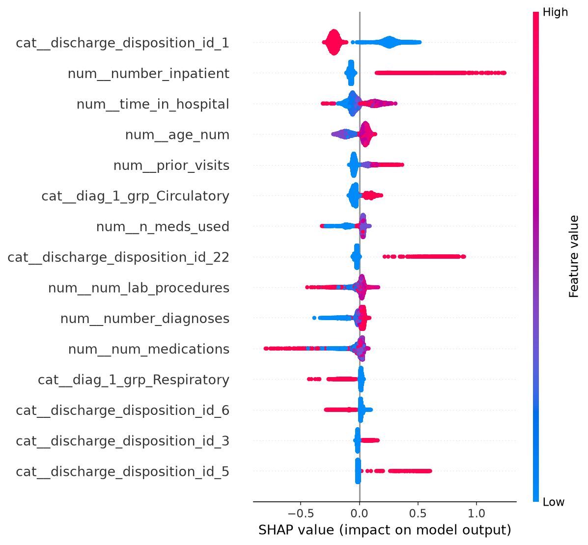
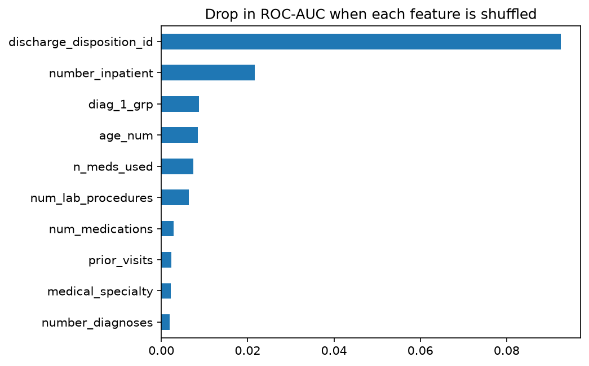
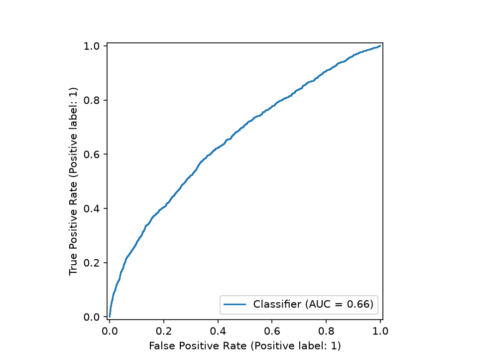

# Predicting 30-Day Hospital Readmission for Diabetic Patients

Which diabetic patients are likely to be readmitted within 30 days of discharge? A hospital can use a risk score like this to decide whom to follow up first. US hospitals are penalised for excess readmissions, so this is a real use case.

**Tools:** Python (pandas, scikit-learn, XGBoost, SHAP)

## Key findings

- The tuned XGBoost model achieved a **ROC-AUC of 0.656** and **PR-AUC of 0.188** on the held-out test set.
- Flagging the riskiest 20% of patients captured **38.7% of 30-day readmissions**, compared with approximately 20% under random selection.
- SHAP and permutation importance highlighted **discharge disposition, prior inpatient utilization, length of hospital stay, age, and diagnosis group** as important model features.





## Data

- [Diabetes 130-US Hospitals for Years 1999–2008](https://archive.ics.uci.edu/dataset/296/diabetes+130-us+hospitals+for+years+1999-2008), UCI Machine Learning Repository
- 101,766 hospital encounters with 50 columns; 69,987 patients after cleaning, with a 9% 30-day readmission rate.
- Source paper: Strack B. et al. (2014). Impact of HbA1c Measurement on Hospital Readmission Rates: Analysis of 70,000 Clinical Database Patient Records. *BioMed Research International*.

## Approach

1. Removed patients who died or were discharged to hospice, and kept each patient's first encounter so the same patient can't appear in both training and test data.
2. Engineered features: age-band midpoints, prior visits, diabetes medicines used and changed, and ICD-9 diagnosis codes grouped into 9 clinical categories.
3. Built a scikit-learn pipeline that scales numeric columns and one-hot encodes categorical ones.
4. Compared a baseline, Logistic Regression, Random Forest and XGBoost with 5-fold stratified cross-validation on ROC-AUC, using class weights for the 9% minority class.
5. Tuned XGBoost with a grid search, then scored it once on a held-out 20% of patients.
6. Explained the model with SHAP values and permutation importance.



## Why not accuracy?

Only about 9% of patients are readmitted, so a model that always predicts "no" is 91% accurate and completely useless. ROC-AUC and the top-20% capture rate measure what matters: how well the model ranks patients by risk.

## How to run

```bash
pip install -r requirements.txt
```

1. Download the dataset zip from the UCI page above and put `diabetic_data.csv` and `IDS_mapping.csv` in `data/`.
2. Run the notebook top to bottom (about 5 minutes on a laptop).

## Limitations

- The data covers 1999–2008 and uses ICD-9 codes.
- Social factors, such as living alone or access to follow-up care, aren't recorded, which caps how well any model can do.
- Keeping only first encounters loses some information but prevents leakage between training and test data.

## Next steps

- Calibrate the predicted probabilities and choose an alert threshold based on the cost of follow-up calls.
- Test the model on more recent data coded in ICD-10.

---

**Govind Bansal** · B.Pharm, BITS Pilani · [LinkedIn](https://www.linkedin.com/in/your-handle) · [GitHub](https://github.com/your-handle)
